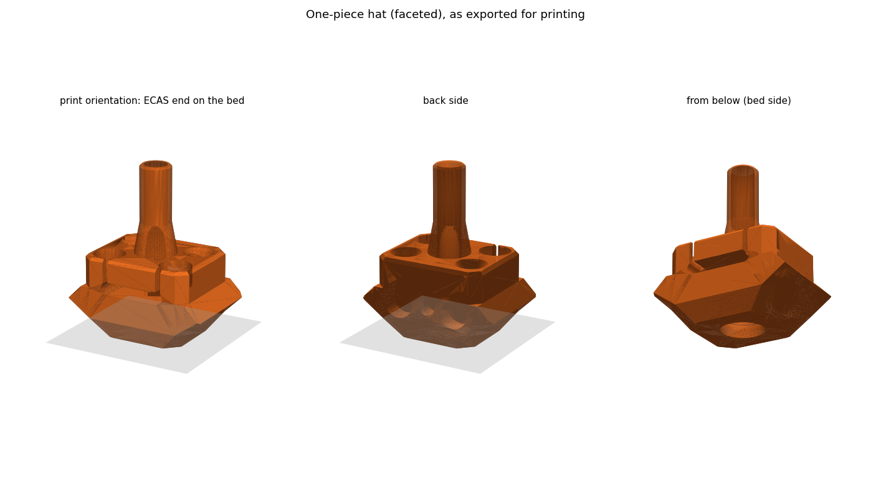
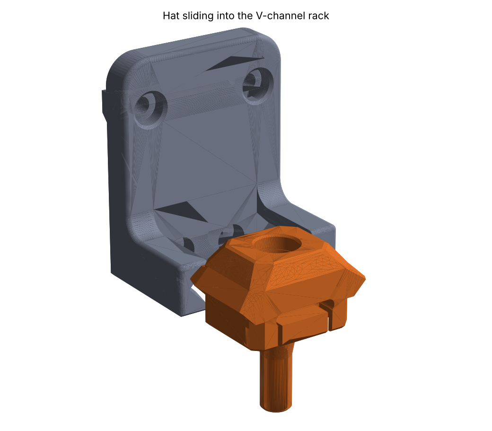

# HatChanger

[](https://github.com/fulippo/hatchanger/actions/workflows/tests.yml)
[](LICENSE)

**A multi-filament changer for Voron printers that swaps only the top of the extruder, not the whole tool.**

HatChanger keeps one hotend and one extruder on the toolhead. Each filament lives in its own
**hat**: a small printed cartridge holding the end of its bowden tube. To change filament, the
Stealthburner parks the current hat in a rack on the top front extrusion, pulling the filament
out of the extruder as it moves away. It then rises under another hat, and the Galileo 2 grabs
the new filament on the way up. A [FilamATrix](https://github.com/thunderkeys/FilamATrix) blade
cuts the filament before each unload, so no tip forming is needed.

> [!WARNING]
> **Early development.** The parts and macros are being tested on a Voron 2.4. Expect changes,
> and expect to calibrate. Failures stop with an error; there is no automatic retry yet.



## Features

- **No tool docking.** One hotend, one extruder. Each lane adds only a printed hat, an ECAS04,
  a few magnets and a rack.
- **Passive lanes.** No motors, servos or electronics per lane.
- **Sensor-referenced moves.** Every unload and pickup is checked against an after-gears
  filament sensor, never dead reckoning.
- **Built-in cutter.** The FilamATrix arm cuts the filament before each unload.
- **Self-centring, captive hats.** Dowel pins, magnets and a printed cone locate the hat on the
  head; V-rails keep it captive in its rack.
- **Klipper macros, standalone or under [AFC](docs/AFC.md).** One-command installer with
  Moonraker update-manager support.
- **Parametric CAD.** One CadQuery script generates every part from the official Galileo 2 and
  FilamATrix models.

## How it works

1. **Dock (`HAT_DOCK`):** the head presses the FilamATrix arm against a pin to cut the filament,
   retracts the cut end to just below the gears, slides the hat into its rack, then moves down
   while the extruder reverses, so the filament stays in the hat and slips out of the gears.
2. **Pick up (`HAT_PICKUP`):** the head rises under the next hat with the extruder turning in
   sync, so the gears catch the hanging filament as the hat seats. The sensor confirms the grab,
   and the filament is loaded to the nozzle. The purge macro pushes out the old cut stub.



## Requirements

- Voron 2.4 with a Stealthburner and a [Galileo 2](https://github.com/JaredC01/Galileo2) extruder
  (stock G2E toolhead board mount)
- The [FilamATrix](https://github.com/thunderkeys/FilamATrix) cutter, G2E version
  (HatChanger's `front_body_hatchanger` replaces its `front_body_g2e`)
- An Omron D2F switch on a free toolhead board input, for the after-gears sensor
- Klipper with `[save_variables]` and `[respond]`
- A printer that can print ABS/ASA

## Quick start

1. **Print and assemble** the parts in [`cad/stl`](cad/stl) following the
   [bill of materials](docs/BOM.md).
2. **Install the macros** on the printer:

   ```sh
   cd ~ && git clone https://github.com/fulippo/hatchanger.git
   ./hatchanger/install.sh
   ```

3. **Calibrate** the dock and cutter positions, then **test** the lanes.

The full walkthrough is in [docs/INSTALL.md](docs/INSTALL.md).

## Documentation

| Document | Contents |
|---|---|
| [Installation](docs/INSTALL.md) | Printing, installer, calibration, testing, slicer setup |
| [Commands](docs/COMMANDS.md) | Reference for every `HAT_*` macro |
| [Bill of materials](docs/BOM.md) | Hardware, print settings, assembly notes |
| [AFC integration](docs/AFC.md) | Running HatChanger as an Armored Turtle AFC unit |
| [Hat ID](docs/HAT_ID.md) | Optional resistor-based hat identification |
| [CAD](docs/CAD.md) | Part descriptions and rebuilding the models |
| [Roadmap](ROADMAP.md) | Known limitations and planned work |

## Repository layout

```
cad/            CadQuery sources, STEP and STL exports
docs/           documentation and images
klipper/        Klipper macros, the AFC unit driver and integration tests
scripts/        config-editing helper used by install.sh
tests/          installer tests
install.sh      installer
```

## Contributing

Issues and pull requests are welcome. See [CONTRIBUTING.md](CONTRIBUTING.md).

## Acknowledgements

- [Galileo 2](https://github.com/JaredC01/Galileo2) by JaredC01: the extruder and the base of
  the front body.
- [FilamATrix](https://github.com/thunderkeys/FilamATrix) by thunderkeys, Wondro and
  ArmoredTurtle: the cutter and the front body HatChanger builds on. FilamATrix is itself based
  on [Filametrix](https://github.com/sorted01/Filametrix) by sorted01 and G2E-Filametrix by
  IRTrail.
- [Voron Design](https://vorondesign.com) for the Voron 2.4 and the Stealthburner.
- Bondtech INDX, for the idea of changing only part of the tool.

## License

HatChanger is released under the [GNU General Public License v3.0](LICENSE).
`front_body_hatchanger` is derived from FilamATrix and Galileo 2, both GPL-3.0.
