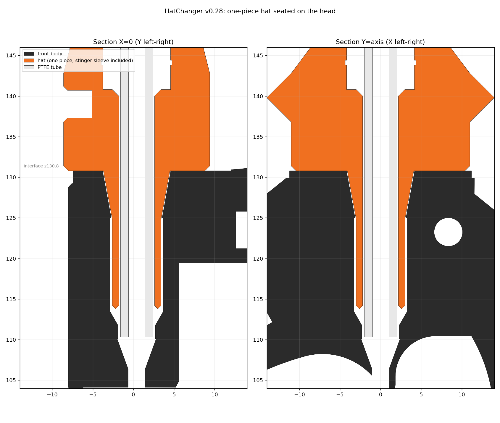
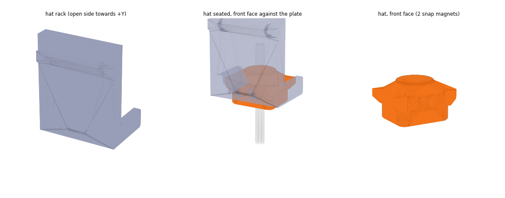
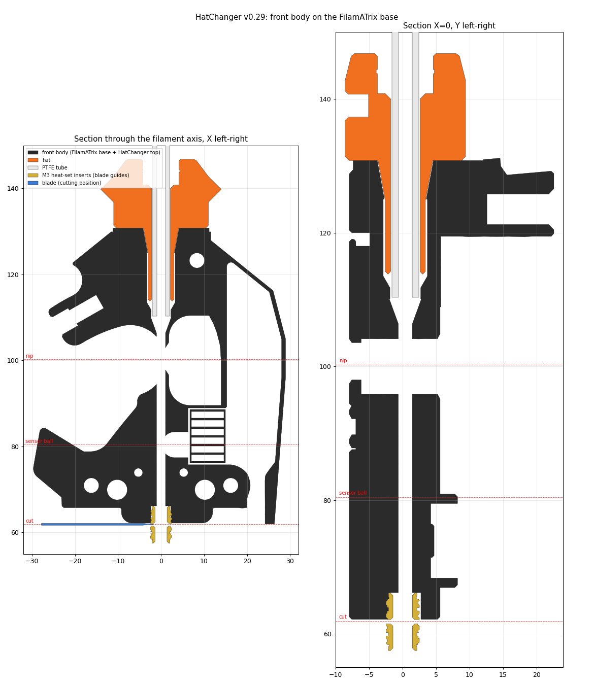
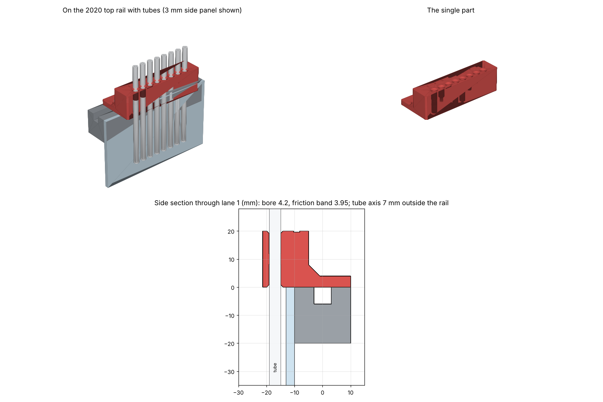

# CAD

## Parts

| Part | Qty | What it does |
|---|---|---|
| `front_body_hatchanger` | 1 | Replaces the Galileo 2 `front_body`. Built on the FilamATrix G2E front body: its bottom half holds the upper blade guide (M3 heat-set insert), the filament channel, the after-gears sensor (19.85 mm below the gears) and the cutting-arm clearance. The top is the hat interface: a flat pad, two dowel pins at the front, two magnets at the back (also the hat-ID contacts, wired through a channel behind them that exits on the +X side), the cone socket and a lead-in into the gears. FilamATrix's pre-gear sensor isn't used: its pocket is filled solid. |
| `hat` | 1 per lane | Printed in one piece, faceted so it prints upside down without supports. ECAS04 on top. The bowden runs straight through and ends 20.5 mm below the hat, inside a printed cone and sleeve that seat in the head. Magnets underneath (to the head) and in the front face (to the rack), plus V-ridge side rails with a tapered nose. A slot in the back face holds the optional hat-ID resistor. |
| `hat_rack` | 1 per lane | V-channel bolted to the top front extrusion. The hat's rails slide between a lower and an upper 45° lip on each side wall (1.2 mm of vertical play, flared mouth). Two magnet pairs snap the hat against the plate. |
| `hat_rack_spacer_12` / `_17` | optional | Moves a rack 12 or 17 mm off the extrusion, towards the chamber, if the head can't reach far enough. |
| `stinger_gauge` | 1 | Assembly jig that sets how far the bowden sticks out of each hat. |
| `ptfe_rail_clamp` / `_4x` | optional | Holds 8 (or 4) bowden tubes side by side, vertical, just outside the frame, on top of a 2020 extrusion. Guides the tubes and keeps them apart; it doesn't grip them. |

| | |
|---|---|
|  |  |
|  |  |

## Building

All parts are generated by [`cad/source/hatchanger_cad.py`](../cad/source/hatchanger_cad.py)
(CadQuery). It needs the official Galileo 2 STEP and the FilamATrix assembly STEP:

```sh
pip install cadquery trimesh
git clone --depth 1 https://github.com/JaredC01/Galileo2.git
git clone --depth 1 https://github.com/thunderkeys/FilamATrix.git
unzip FilamATrix/CAD/Stealthburner_FilamATrix.step.zip -d FilamATrix/CAD
python cad/source/hatchanger_cad.py "Galileo2/galileo2_extruder/cad/Galileo 2 Extruder.step" \
    --filamatrix FilamATrix/CAD/Stealthburner_FilamATrix.step
```

- **Output:** parts go to `./out` as STEP and watertight STL, plus an assembly STEP for checking
  fits.
- **Faster rebuilds:** reading the FilamATrix STEP takes a few minutes. The first build caches
  the front body as `filamatrix_front_body.brep` next to it; pass that file to `--filamatrix` to
  skip the wait.
- **Parameters:** every dimension and clearance is a field of the `P` dataclass at the top of the
  script, e.g. `cone_clear` (cone fit in the head), `seat_d`, the magnet and pin positions, and
  the rack clearances.
- **Logo (optional):** `--logo file.svg` engraves an SVG on the rack's front plate, fitted into
  28 × 16 mm. It needs `svgelements` and filled paths; convert text to paths first.

### PTFE rail clamp

Standalone, no input files:

```sh
python cad/source/ptfe_rail_clamp.py [--lanes N] [--grip D]
```

Lane count, pitch and bore diameter (`BORE_D`) are constants at the top of the script.
`--grip D` adds a tighter friction band in the middle of each bore (off by default), and
`--grip-test` builds a strip of band sizes to choose it.
