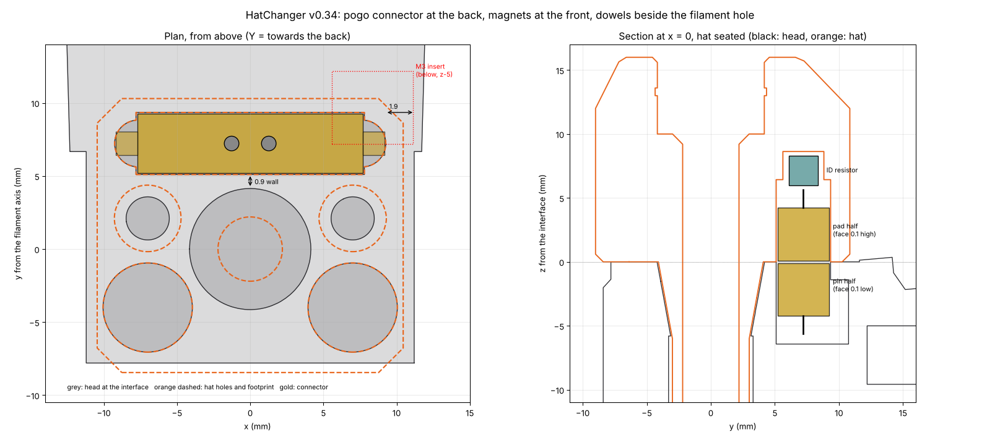

# CAD

One folder per component, each with the CadQuery script in `source/` and the exports in `stl/`
and `step/`:

```
cad/hatchanger/        front body, hat, hat rack (+ spacers), stinger gauge
cad/ptfe_rail_clamp/   optional bowden clamp
cad/tophat/            optional heated-chamber top hat: stl/<size>/ for 250, 300, 350
```

## Parts

| Part | Qty | What it does |
|---|---|---|
| `front_body_hatchanger` | 1 | Replaces the Galileo 2 `front_body`. Built on the FilamATrix G2E front body: its bottom half holds the upper blade guide (M3 heat-set insert), the filament channel, the after-gears sensor (19.85 mm below the gears) and the cutting-arm clearance. The top is the hat interface: a flat pad, two magnets at the front, two dowel pins beside the filament hole, the pin half of a 2-pin magnetic pogo connector at the back (it holds the hat down and carries the hat ID), the cone socket and a lead-in into the gears. FilamATrix's pre-gear sensor isn't used: its pocket is filled solid. |
| `hat` | 1 per lane | Printed in one piece, faceted so it prints upside down without supports. ECAS04 on top. The bowden runs straight through and ends 20.5 mm below the hat, inside a printed cone and sleeve that seat in the head. Two magnets underneath at the front and the pad half of the pogo connector at the back (to the head, with the ID resistor above it), magnets in the front face (to the rack), plus V-ridge side rails with a tapered nose. |
| `hat_rack` | 1 per lane | V-channel bolted to the top front extrusion. The hat's rails slide between a lower and an upper 45° lip on each side wall (1.2 mm of vertical play, flared mouth). Two magnet pairs snap the hat against the plate. |
| `hat_rack_spacer_12` / `_17` | optional | Moves a rack 12 or 17 mm off the extrusion, towards the chamber, if the head can't reach far enough. |
| `stinger_gauge` | 1 | Assembly jig that sets how far the bowden sticks out of each hat. |


| `ptfe_rail_clamp` / `_4x` | optional | Holds 8 (or 4) bowden tubes side by side, vertical, just outside the frame, on top of a 2020 extrusion. Guides the tubes and keeps them apart; it doesn't grip them. |
| `tophat_*` | optional | Heated-chamber top hat: an 85 mm canopy wall on the top extrusions with 2020 T-slots on top and inside, foam gaps between pieces and grommeted bowden exits at the back. See [TOPHAT.md](TOPHAT.md). |
