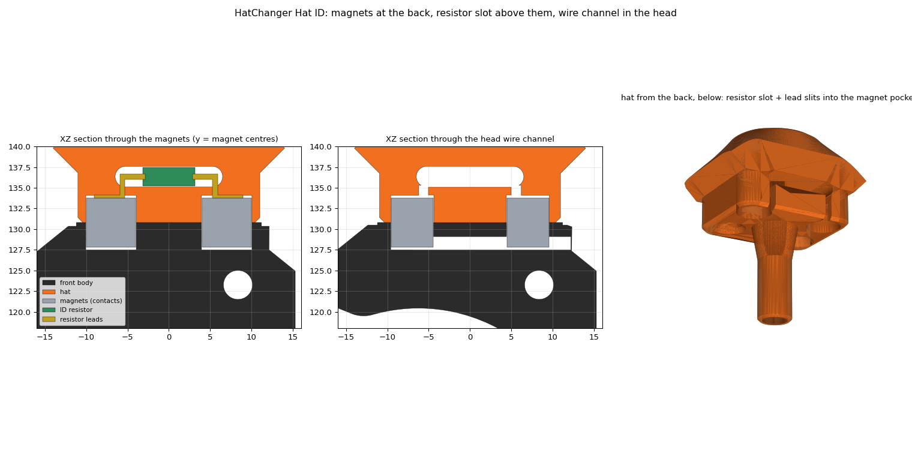

# Hat ID (optional)

Each hat can carry a resistor that tells Klipper which hat is on the head. The two bottom
magnets of the hat and the two pad magnets of the head double as electrical contacts; an
ADS1115 on the toolhead board's I2C bus measures the resistor. No firmware is needed: Klipper
reads the ADS1115 directly through its `[ads1x1x]` module.

## Circuit

Any ADS1115 breakout module works, wired like this:

- **Divider:** a 10 kΩ (1 %) resistor from 5 V to the hat contact, the other contact to GND.
  The ADS1115 reads the midpoint on **AIN0**, through a 1 kΩ / 100 nF RC filter.
- **Reference:** **AIN1** reads the 5 V rail through the same 1 kΩ / 100 nF, so
  `R_hat = 10k × V(AIN0) / (V(AIN1) − V(AIN0))` doesn't depend on the exact supply voltage.
- **Bus:** the ADS1115 runs at 5 V at address 0x48 (ADDR to GND). On an SB2209 USB, use the
  `I2C` header (5V, GND, SCL = GPIO29, SDA = GPIO28), which is level-shifted to 5 V and already
  has pull-ups.

## Hat resistors

| Lane | 0 | 1 | 2 | 3 | 4 | 5 |
|---|---|---|---|---|---|---|
| Resistor (¼ W, 1 %) | 1k | 2.2k | 4.7k | 10k | 22k | 47k |

Any set works if neighbours are at least ~1.7× apart and stay between ~220 Ω and ~100 kΩ. Set
the values in `lane_ohms` in `hatchanger_user.cfg`.

Assembly of the contacts is described in the [bill of materials](BOM.md#assembly-notes).

## Configuration

Install with `./hatchanger/install.sh --hat-id`, then in `hatchanger_user.cfg`:

- set your toolboard's `[mcu]` name in `[ads1x1x hat_adc]`;
- set each hat's resistor in `lane_ohms`.

`HAT_ID` reports the hat on the head and `HAT_ID_CHECK LANE=n` errors unless hat `n` is there.
The standalone change macros don't call them yet; the [AFC unit](AFC.md#unit-options) does
(`hat_id_check`).
