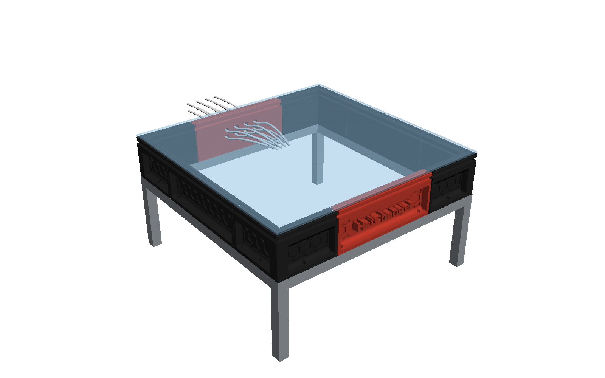
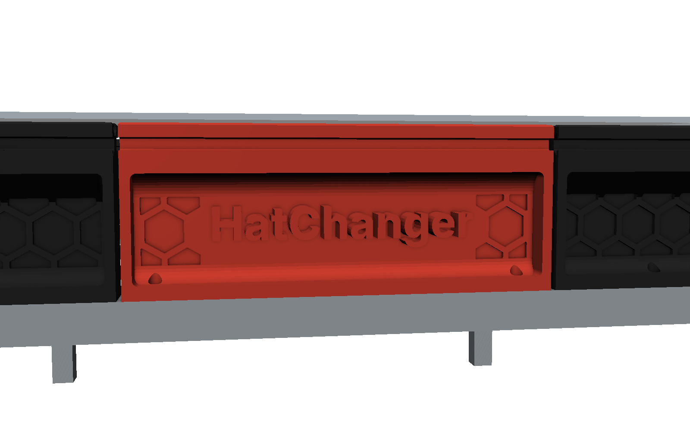
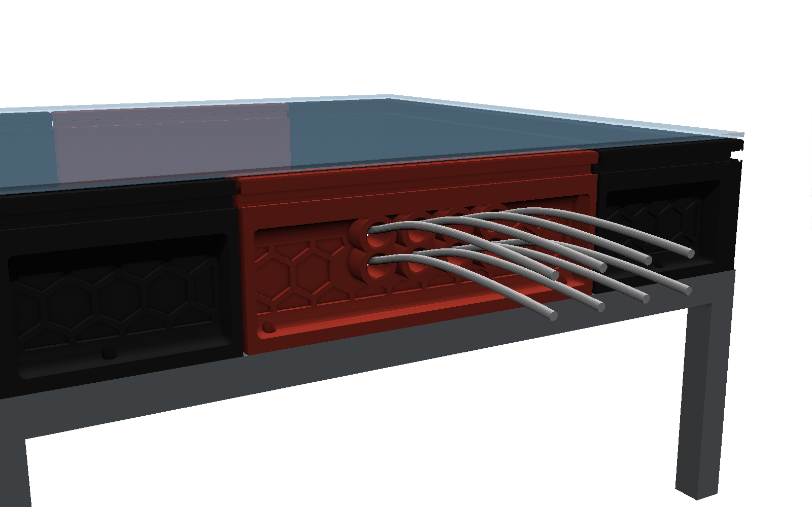
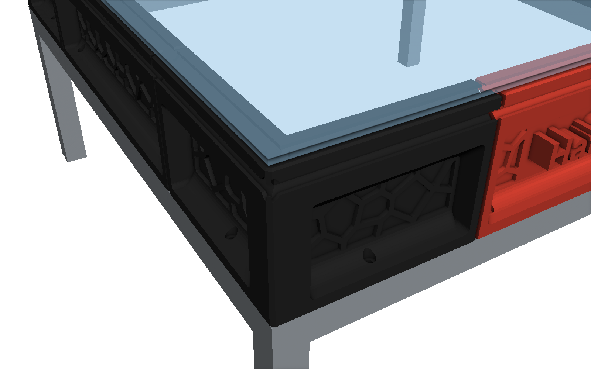
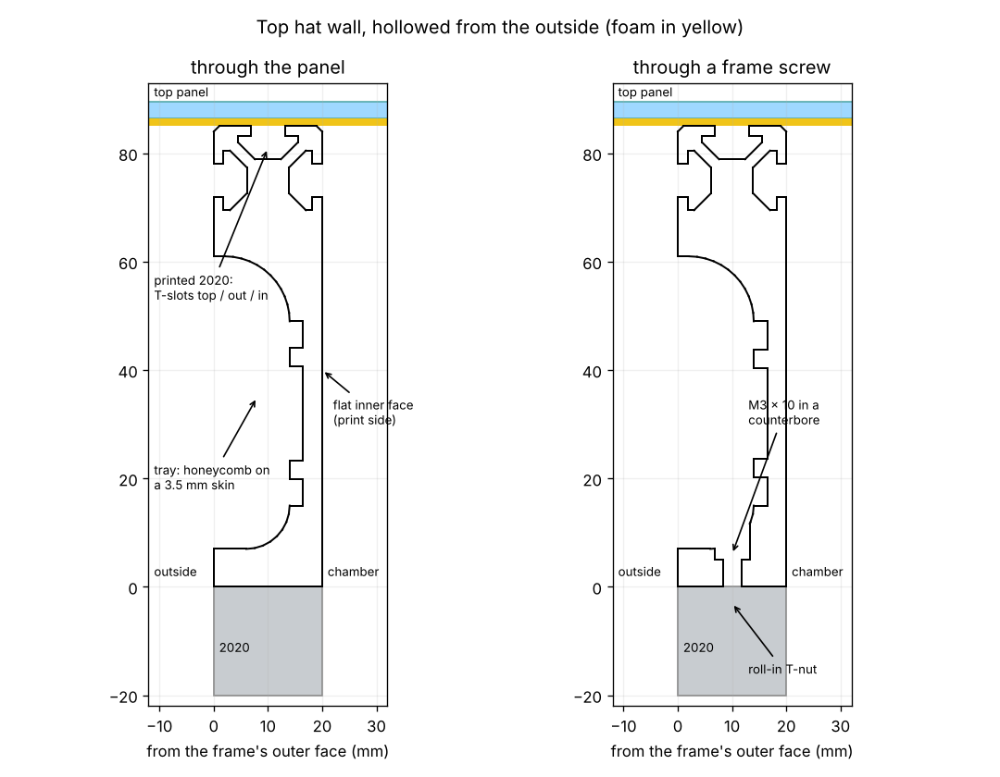

# Top hat (heated chamber)

The bowden tube of the loaded hat follows the toolhead, and its arc rises about 60 mm above the
top extrusions (docked, and at max Z). The top hat raises the stock top panel so the chamber stays
closed: an 85 mm wall standing on the top extrusions, with the tubes leaving through grommets in
the rear wall.



## Design

- **Same footprint as the frame.** The wall is 20 mm wide, right on top of the top extrusions,
  so the inside of the chamber is unchanged and the stock top panel sits on top of it.
- **A printed 2020 on top.** The top 20 mm of the wall has T-slots on the top, outer and inner
  faces (6.2 mm opening, 6.1 mm deep). Panel clips, LED bars, tube guides and anything else you
  clamp on a top extrusion fit here, with roll-in or spring T-nuts. The outer slot wraps around
  the corners. The walls between the slots are thin, as on a real 2020, so clamp light parts.
- **Hollowed from the outside.** Below the top band the outer face is a deep tray with the
  honeycomb on its floor, on a 3.5 mm skin; the inner face (chamber side) is flat. Fillets
  (12 mm at the top, 8 mm at the bottom) brace the skin against the top band and the foot. Full 20 mm
  only where it matters: the top band, the 7 mm foot, the corner columns, the piece ends and
  the bosses round the bowden exits. The front letters stand on the tray floor.
- **Foam gaps.** The pieces are 2.5 mm apart: fill each joint with a 3 mm closed-cell foam strip.
  Foam tape also goes under the wall (on the extrusion) and under the panel.
- **Screwed to the frame.** Two M3 × 10 screws per piece, through the 5 mm foot into roll-in
  T-nuts in the frame's top slots. Each hole has a 6.5 mm counterbore opening into the tray, so
  the screw is tightened from outside the printer with the short arm of a 2.5 mm L-key.
- **Bowden exits at the back.** The rear centre has 8 holes of 12 mm (2 rows of 4, 35 and 51 mm
  above the frame) with TPU grommets: 4.3 mm bore and a 3.8 mm lip that seals on the 4 mm PTFE
  while letting it slide. Unused holes take the blank plug.
- **Voron style.** Recessed panels with a honeycomb (or voronoi) pattern, chamfered edges, a
  plain 20 mm column at each corner over the vertical extrusion, "HatChanger" on the front.

| Front | Rear |
|---|---|
|  |  |

| Corner (honeycomb) | Corner (voronoi) |
|---|---|
|  |  |



## Parts

Files for the Voron 2.4 250, 300 and 350 are in [`cad/tophat/stl/<size>`](../cad/tophat/stl).
Every piece fits a 250 mm bed. Print in ASA/ABS, no supports, as exported:

- **Centres** lying on their flat inner face, pattern and letters up.
- **Corners** upright, bottom on the bed (the trays have 45° roofs).

3–4 walls and 10–15 % infill are plenty.

| Part | Qty | Where |
|---|---:|---|
| `tophat_<size>_corner` | 4 | Corners: one design, rotated (120 × 120 × 85 mm, the same for every size) |
| `tophat_<size>_centre` | 2 | Left and right sides |
| `tophat_<size>_centre_front` | 1 | Front, "HatChanger" plaque |
| `tophat_<size>_centre_rear` | 1 | Rear, bowden exits |
| `tophat_grommet_tpu` | 1 per tube | TPU 95A, in the rear holes, flange outside (all sizes) |
| `tophat_plug_tpu` | 1 per unused hole | TPU 95A (all sizes) |

| Size | Frame | Centre pieces | Filament, 4 walls 15 % (approx.) |
|---|---:|---:|---:|
| 250 | 410 mm | 165 × 85 × 20 mm | 1.0 kg |
| 300 | 460 mm | 215 × 85 × 20 mm | 1.1 kg |
| 350 | 510 mm | 265 × 85 × 20 mm | 1.3 kg |

The `_voronoi` files are the same pieces with a voronoi pattern instead of the honeycomb.

## Hardware

| Qty | Item |
|---:|---|
| 16 | M3 × 10 socket head screw |
| 16 | M3 roll-in (spring) T-nut for 2020, in the frame's top slots |
| ~4 m | 3 mm closed-cell foam tape, 10–20 mm wide (joints, under the wall, under the panel) |
| – | T-nuts for the printed slots as needed (panel clips etc.) |
| 1 | 2.5 mm L-key |

## Fitting

1. Put foam tape on the top face of the top extrusions, leaving the slot open where the screws go.
2. Drop a roll-in T-nut into the frame's top slot under each screw hole.
3. Place the corners, then the centres, with a foam strip in each 2.5 mm joint.
4. Drop an M3 × 10 into each counterbore (bottom of the trays) and tighten it with the L-key.
5. Push the grommets into the rear holes from outside, thread the bowdens through them.
6. Foam tape on top of the wall, then the top panel, held with panel clips in the printed top slot.

## Rebuilding

```
python3 cad/tophat/source/tophat.py                          # every size, both patterns
python3 cad/tophat/source/tophat.py --size 300 --pattern hex # one size, one pattern
python3 cad/tophat/source/tophat.py --size 300 --height 95   # taller wall
```

Files go to `cad/tophat/stl/<size>/` and `cad/tophat/step/<size>/`; the grommet and plug, the same
for every size, to `cad/tophat/stl/` and `cad/tophat/step/`.

Everything else (corner arm length, foam gap, slot dimensions, text, hole layout, pattern pitch)
is in the `C` dataclass at the top of the source.
